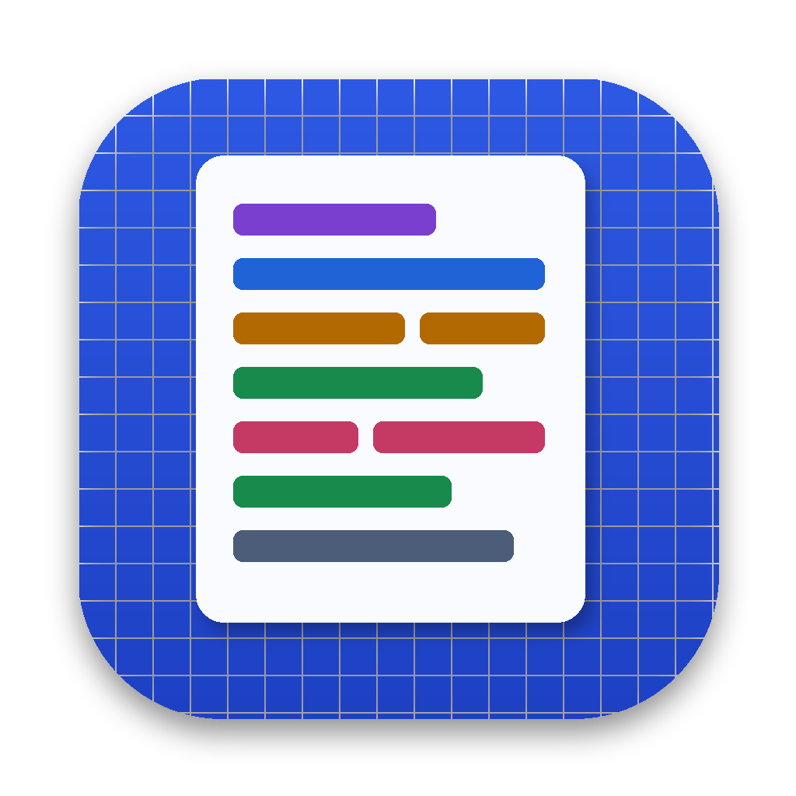

<p align="center"></p>

# HSC Essay Engine

**Content v2.0.0 · Mac app v1.1.0** · A training tool for NSW HSC English Advanced essays, built for the new English Advanced 11–12 Syllabus (2024), first examined in 2027. Currently focused on Gwen Harwood (Common Module).

The whole essay as one formula: **TCR · PQTEL ×3 · RS**. Thesis = idea + twist.

## What's inside

| Section | What it does |
|---|---|
| Start here | Where Harwood fits in the exam, the one-line essay formula, what markers want |
| The formula | Thesis, intro (TCR), QTE, paragraph (PQTEL), conclusion (RS), 5-minute plan, each with a try-it mission |
| Analysis ladder | One Harwood quote analysed at six levels |
| Harwood's 7 poems | Story, ideas, form, starter quotes and a personal quote bank for each poem; ideas mind map; context hooks |
| Watch it built | Animated builds of a thesis, a QTE and a full paragraph |
| Exemplar | Colour-coded essay on Barn Owl, The Glass Jar, Nightfall and The Violets |
| Missions | 11 try-it tasks with codes (HW-T1, HW-Q1…) that copy straight into a Claude chat |
| Drills | Which poem?, technique ID, spot the part, weak/strong, verbs, decode, ordering |
| Timed writing | Sprints, self-audit, copy for marking |
| Plan | 14-day Harwood sprint |

## Two versions

- **`web/index.html`**: open in any browser. Works offline. Progress is saved in that browser.
- **`mac/`**: native Mac app wrapper. Build with:
  ```
  cd mac
  bash build.sh --install
  ```
  Needs the Xcode command line tools (`xcode-select --install`).

  **Updates:** the app checks this repo on launch (and via *Check for Updates…*, Cmd U). When `web/index.html` has a higher `VERSION`, it downloads and installs it automatically. This only works while the repo is **public**.

AI marking against the NESA criteria is only available in the claude.ai-hosted version of the page.

## Notes

- The model essay is original, written to the published 17–20 marking criteria. NESA does not publish real 20/20 scripts. Check quotes against your own edition of the prescribed text.
- Sources: NESA English Advanced 11–12 Syllabus (2024) exam specifications and course structure, and NESA's 2024 and 2025 HSC English Advanced marking guidelines and marking feedback.
